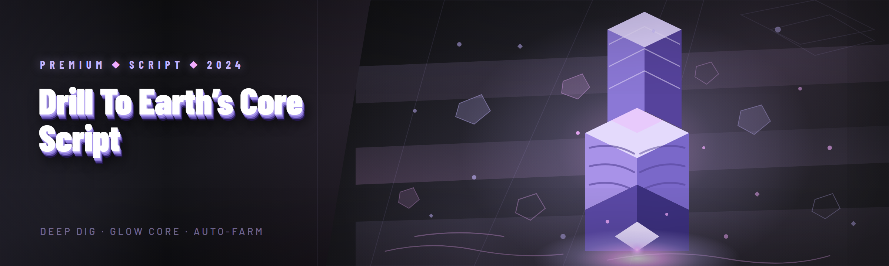

  
  
  

  

  
  
  

---

**Drill to Earth’s Core Script — 2026 Pro Build**

*A standalone Windows macro that automates the mining loop, manages heat and pressure, and keeps your drill from melting halfway to the mantle.*

---

## 📊 Module Status — Verified Before Anything Else

I run every module through a clean-save test pass before each release. Here is the current state of the 2026 build. If a row is not ✅, it is not shipped.

| Module | Status | Description |
|---|---|---|
| Auto-Drill Loop | ✅ Working | Holds the drill trigger, cycles idle states, resumes on cooldown |
| Heat Governor | ✅ Working | Cuts drilling at configurable thermal thresholds |
| Pressure Balancer | ✅ Working | Vents pressure before the hull integrity check fires |
| Depth Tracker | ✅ Working | Reads depth from the HUD and logs it to a local file |
| Core Proximity Alert | ✅ Working | Audio + overlay ping when you cross the last biome threshold |
| Ore Priority Filter | ✅ Working | Skips low-value veins, stops on rare ore signatures |
| Coolant Manager | ✅ Working | Tracks coolant reserves and pauses when low |
| Auto-Repair Trigger | ✅ Working | Queues repair at the nearest station when hull drops below X |
| Return-to-Surface Macro | ✅ Working | Full ascent sequence with staged safe-stop points |
| Save-State Guard | ✅ Working | Snapshots before risky depth pushes |
| Overlay HUD | ✅ Working | On-screen readout of depth, heat, pressure, coolant |
| Config Hot-Reload | ✅ Working | Edits to the profile file apply without restarting |

> Every row above was tested on a fresh save and a mid-run save. Edge cases are documented in the FAQ below.

---

## 🧭 Table of Contents

- [The Problem](#-the-problem)
- [Community & Support](#-community--support)
- [System Requirements](#-system-requirements)
- [Quick Start](#-quick-start)
- [Roadmap](#-roadmap--planned-features)
- [Installation](#-installation)
- [Compatibility](#-compatibility--platform-support)
- [Hotkeys & Controls](#-hotkeys--controls)
- [Usage Guidelines](#-usage-guidelines)
- [What Is a Drill to Earth’s Core Script?](#-what-is-a-drill-to-earths-core-script)
- [How It Works](#-how-it-works)
- [Module Catalog](#-module-catalog)
  - [Drilling & Depth Modules](#-drilling--depth-modules)
  - [Thermal & Pressure Modules](#-thermal--pressure-modules)
  - [Resource & Ore Modules](#-resource--ore-modules)
  - [Safety & Recovery Modules](#-safety--recovery-modules)
  - [Overlay & Logging Modules](#-overlay--logging-modules)
  - [Utility & Config Modules](#-utility--config-modules)
- [Known Issues](#-known-issues)
- [Changelog](#-changelog)
- [FAQ](#-faq)
- [Download v2026 Build](#-download-v2026-build)

---

## 🧩 The Problem

If you have played a "drill to the core" style game for more than an hour, you already know the loop is punishing in ways that are not fun:

- **The trigger hold is brutal.** Holding the drill input for 40+ minutes straight is a wrist injury waiting to happen, and the game does not offer a toggle.
- **Heat creeps up silently.** The thermal gauge sits out of your peripheral vision and by the time you notice, the drill is already venting and you lost progress.
- **Pressure events feel random** even when they are not — they are depth-gated, but the HUD does not tell you that.
- **Rare ore is easy to miss** because the vein-flash window is under a second and your eyes are on the depth counter.
- **Returning to the surface is a chore.** You have to stage coolant, repairs, and safe-stops manually, and one wrong step ends a two-hour run.
- **You cannot pause progress.** Alt-tabbing to check a wiki mid-run usually means a melted drill.
- **Config is buried in save files.** Every tweak means closing the game, editing a file, and reloading.

That is the exact list of things this script exists to remove.

---

## 🧑‍🤝‍🧑 Community & Support

This started as a personal fix and got open-sourced because the Discord kept asking for it. Everything below is community-run:

- **Issue tracker** — bug reports and feature requests live in the GitHub Issues tab. Please include your depth, biome, and a copy of the log file.
- **Discussions tab** — for config sharing and "is this normal?" questions.
- **Profiles repo branch** — community-submitted config profiles for different playstyles (conservative, speedrun, idle).
- **Update channel** — the landing page always hosts the current `.exe`. There is no auto-updater; you re-download when a release notes post goes up.

I am one person, so replies are usually within a day or two. If you find a bug, a minimal reproduction save is worth more than a paragraph.

---

## 🖥️ System Requirements

| Component | Minimum | Recommended |
|---|---|---|
| OS | Windows 10 64-bit (build 1909+) | Windows 11 23H2+ |
| CPU | Dual-core 2.4 GHz | Quad-core 3.0 GHz+ |
| RAM | 4 GB | 8 GB |
| GPU | Integrated, DX11 | Dedicated, DX12 |
| Storage | 60 MB free | 200 MB free (logs + profiles) |
| Runtime | .NET Desktop Runtime 6 | .NET Desktop Runtime 8 |
| Permissions | Standard user | Standard user (admin NOT required) |
| Display | 1280×720 | 1920×1080 (overlay scales) |

The `.exe` does **not** require admin rights. If a guide tells you to run it as administrator, that guide is wrong — the script only touches its own config folder and the game window.

---

## ⛏️ Quick Start

The whole flow is download → extract → run. No package managers, no cloning, no terminals.

1. 📄 Go to the project landing page (linked from the GitHub repo description) and grab the current build.
2. 🗂️ Extract the `.zip` to a normal folder — **not** Program Files, and not a synced OneDrive folder. The script writes logs and profiles next to the `.exe`.
3. 🎮 Launch your game first and get to the drilling screen so the window exists.
4. 🖱️ Double-click the `.exe`. A small tray icon appears; the overlay HUD draws on top of the game only.
5. ⌨️ Press `F8` to open the config panel, pick a profile, and hit **Apply**. Then press `F9` to arm the macro.

That is it. If the overlay does not appear, see [Known Issues](#-known-issues) — it is almost always a fullscreen-exclusive setting.

---

## 🗺️ Roadmap / Planned Features

| Feature | Status | ETA |
|---|---|---|
| Auto-drill v2 (adaptive trigger timing) | ✅ Shipped | — |
| Heat governor with predictive cutoff | ✅ Shipped | — |
| Multi-profile hot-swap | ✅ Shipped | — |
| AI ore classifier (visual vein recognition) | 🟡 In testing | Q2 2026 |
| Real-time depth telemetry export (CSV) | 🟡 In testing | Q2 2026 |
| Route planner for optimal ascent | 🔵 Planned | Q3 2026 |
| Second-monitor dedicated HUD | 🔵 Planned | Q3 2026 |
| Steam Deck / Proton compatibility notes | 🔵 Planned | Q4 2026 |
| Community profile browser (in-app) | ⚪ Backlog | TBD |

---

## 📥 Installation

1. **Download and extract.** Right-click the downloaded `.zip` → *Extract All* → choose a plain folder like `C:\Games\DrillMacro`. Do not run the `.exe` from inside the `.zip` — the config writer will fail silently.
2. **First run.** Double-click the `.exe`. Windows SmartScreen may show a "unknown publisher" prompt because this is an unsigned hobby build — click *More info* → *Run anyway*. The app creates `config/`, `logs/`, and `profiles/` next to itself on first launch.
3. **Configure and arm.** Open the panel with `F8`, select a profile, apply, then `F9` to arm. The tray icon turns green when the macro is active and grey when disarmed.

If antivirus flags it, that is a false positive from the input-injection library — you can whitelist the folder or build from source. Do not disable your whole AV suite.

---

## 🧱 Compatibility / Platform Support

| Platform | Status | Notes |
|---|---|---|
| Windows 11 (23H2+) | ✅ Full | Default test target |
| Windows 10 (21H2+) | ✅ Full | Verified on clean VM |
| Windows 10 (1909) | ✅ Full | Older overlay path used |
| Windows 8.1 | ⚠️ Partial | Overlay may flicker |
| Linux via Proton | ⚠️ Experimental | Input injection unreliable |
| macOS | ❌ Not supported | No build planned |
| Steam Deck | ⚠️ Experimental | Needs desktop mode + config tweak |
| Borderless windowed | ✅ Full | Recommended display mode |
| Fullscreen exclusive | ⚠️ Partial | Overlay may not draw — see FAQ |
| Multi-monitor | ✅ Full | Overlay follows game window |

---

## ⌨️ Hotkeys & Controls

| Key | Action | Notes |
|---|---|---|
| `F8` | Toggle config panel | Works even when game is focused |
| `F9` | Arm / disarm macro | Tray icon color reflects state |
| `F10` | Panic stop | Immediately releases all inputs |
| `F11` | Toggle overlay HUD | Hides depth/heat readout only |
| `F12` | Snapshot save state | Writes a timestamped copy to `backups/` |
| `Ctrl+Shift+R` | Reload config from disk | Hot-reload without restart |
| `Ctrl+Shift+L` | Open log folder | Quick access for bug reports |
| `Ctrl+Shift+P` | Cycle active profile | Applies next profile in list |
| `Esc` | Close panel | Does not disarm the macro |

Hotkeys are rebindable in `config/hotkeys.json`. If a key conflicts with your game bindings, change it there — the defaults are chosen to avoid common in-game conflicts, but not all of them.

---

## 📜 Usage Guidelines

This is a single-player automation tool for a single-player game. It is not a competitive cheat, and it does not touch multiplayer servers. That said, be a decent human about it:

| Allowed | Not allowed |
|---|---|
| Automating your own single-player drilling loop | Using it in any multiplayer or leaderboard context |
| Sharing config profiles with the community | Repackaging the `.exe` behind a paywall |
| Modifying the source for personal use | Claiming the project as your own |
| Recording and streaming with the overlay on | Using it to grief or harass other players |
| Reporting bugs with logs and saves | Scraping the repo to train a competing product |

If the game you are playing has a terms-of-service clause about third-party automation, read it and make your own call. This project assumes single-player, offline, or private-session play.

---

## 📖 What Is a Drill to Earth’s Core Script?

| Term | Explanation |
|---|---|
| **Macro script** | A program that sends synthetic keyboard/mouse inputs to a game window on a schedule. Not a memory hack, not an injector. |
| **Drill loop** | The repeating cycle of hold-trigger → mine → cool → resume that the game expects you to do manually. |
| **Heat governor** | A module that watches the thermal gauge and interrupts drilling before the vent threshold. |
| **Pressure event** | A depth-gated game event where the hull takes damage unless you vent. |
| **Biome threshold** | A depth marker where the environment rules change (rock type, heat curve, ore table). |
| **Core proximity** | The final depth band before the ending sequence, where heat and pressure both spike. |
| **Profile** | A saved bundle of thresholds and timings. Swap profiles to change playstyle without editing code. |
| **Arming** | The act of telling the macro to start sending inputs. Disarmed = zero input sent. |

Why people use it:

- Removes the physical strain of holding the trigger for a full run.
- Prevents the "I looked away for two seconds and melted" failure mode.
- Makes the return trip repeatable instead of a manual checklist.
- Turns the depth counter into data you can actually read after a run.
- Lets you step away mid-run without losing two hours of progress.

---

## 🔬 How It Works

Under the hood this is deliberately boring, because boring is what makes it reliable. The `.exe` is a single-process Windows desktop app that never touches game memory and never injects a DLL. Instead it runs a tight polling loop against the foreground window: it reads the game's HUD by sampling a small set of screen regions (the thermal gauge, pressure bar, depth readout, and coolant meter), converts those pixels into normalized values, and feeds them into a state machine that decides whether the drill trigger should be held, released, or pulsed. The state machine has explicit states for `IDLE`, `DRILLING`, `COOLING`, `VENTING`, `REPAIRING`, `ASCENDING`, and `PANIC`, and every transition is logged with the pixel readings that caused it — which is why the log file is the first thing I ask for in a bug report. Input is sent through the standard `SendInput` API with configurable hold durations and randomized humanization jitter, so the timing does not look like a metronome. The overlay is a separate topmost layered window that reads from the same state machine and redraws at 10 Hz; it never captures or forwards input itself, so if the overlay crashes the macro keeps running. Config is a plain JSON file watched by a filesystem watcher, which is how hot-reload works without restarting anything. There is no network code in the build at all — no telemetry, no update pings, no license check. That is a deliberate design choice: the fewer moving parts, the fewer things that can break at depth 40.

---

## 🧰 Module Catalog

31 modules across six domains. Each category below lists what it does and what effect you actually see in-game.

### 🪨 Drilling & Depth Modules

| Feature | Effect |
|---|---|
| Auto-Drill Loop | Holds the trigger with humanized timing until a stop condition fires |
| Depth Tracker | Reads the HUD depth counter and logs every 50 m |
| Biome Watcher | Detects biome transitions and swaps threshold sets automatically |
| Pulse Mode | Alternates short drill bursts for ore-sensitive stretches |
| Resume-on-Cooldown | Re-arms the drill the moment the game's cooldown clears |

### 🌡️ Thermal & Pressure Modules

| Feature | Effect |
|---|---|
| Heat Governor | Cuts drilling at your configured thermal ceiling |
| Predictive Cutoff | Watches the heat *rate* and stops early when it is climbing fast |
| Coolant Manager | Pauses drilling when coolant reserves drop below threshold |
| Pressure Balancer | Fires the vent input before the hull integrity check |
| Emergency Vent | Panic-path vent that prioritizes survival over progress |

### 💎 Resource & Ore Modules

| Feature | Effect |
|---|---|
| Ore Priority Filter | Stops the loop when a high-value vein signature appears |
| Vein Flash Detector | Catches the sub-second ore flash you would otherwise miss |
| Skip List | Ignores low-value ore so you do not waste coolant on it |
| Inventory Watcher | Pauses when the ore inventory hits a configurable cap |
| Rare Ore Logger | Writes a timestamped entry for every rare vein found |

### 🛟 Safety & Recovery Modules

| Feature | Effect |
|---|---|
| Save-State Guard | Snapshots the save before risky depth pushes |
| Auto-Repair Trigger | Queues repair at the nearest station below a hull threshold |
| Return-to-Surface Macro | Runs the full staged ascent sequence |
| Safe-Stop Points | Inserts cooldown stops during ascent so heat does not spike |
| Panic Stop | Releases all inputs instantly on `F10` |
| Crash Recovery | Detects a game crash and disarms rather than spamming inputs |

### 📺 Overlay & Logging Modules

| Feature | Effect |
|---|---|
| Overlay HUD | On-screen depth, heat, pressure, coolant readout |
| Session Logger | Writes a plain-text log of every state transition |
| Depth Chart Export | Dumps a CSV of depth-over-time for the session |
| Threshold Alerts | Audio ping when any gauge crosses a warning line |
| Tray Indicator | Color-coded tray icon shows armed/disarmed/error state |

### ⚙️ Utility & Config Modules

| Feature | Effect |
|---|---|
| Config Hot-Reload | Edit the JSON and see changes without restarting |
| Profile Switcher | Cycle between saved profiles with a hotkey |
| Hotkey Rebinder | Remap every hotkey from `hotkeys.json` |
| Update Notifier | Checks the landing page for a newer build on launch |
| Portable Mode | Keeps everything (config, logs, backups) inside the app folder |

---

## 📥 Download v2026 Build

The current stable build is the 2026 release with the AI-assisted ore classifier in testing and real-time overlay updates. Grab it from the project landing page, extract, and run the `.exe`. No installer, no dependencies beyond the .NET Desktop Runtime listed above.

  

---

## 🧯 Known Issues

| Issue | Solution |
|---|---|
| Overlay does not draw in fullscreen-exclusive mode | Switch the game to borderless windowed |
| SmartScreen blocks first launch | Click *More info* → *Run anyway*; the build is unsigned |
| Config edits do not apply | Make sure you saved the JSON; hot-reload watches the file, not the editor buffer |
| Macro disarms on its own | Check the log — usually a crash-recovery trigger or a lost game window |
| Antivirus quarantine | Whitelist the folder; false positive from the input library |
| Overlay flickers on 8.1 | Known; use the older overlay path in config |

---

## 📝 Changelog

- **2026.1** — AI-assisted ore classifier (testing), real-time overlay updates, predictive heat cutoff.
- **2025.4** — Profile hot-swap, panic stop, crash recovery.
- **2025.3** — Return-to-surface macro, safe-stop points, depth chart export.
- **2025.2** — First public release: auto-drill, heat governor, overlay HUD.

---

## ❓ FAQ

| Question | Answer |
|---|---|
| **Will I get banned for using this?** | This is a single-player automation macro with no memory access and no network code. It does not touch multiplayer servers. That said, read your game's ToS and make your own call — I cannot promise anything about a third-party service. |
| **Is it undetectable?** | Nothing is truly undetectable, and anyone who tells you otherwise is selling something. This tool sends synthetic input through the standard OS API. It is not an injector and does not modify game files. |
| **Does it need admin rights?** | No. If a guide tells you to run it as admin, that guide is wrong. It only writes to its own folder. |
| **Does it work on Steam Deck?** | Experimental. You need desktop mode and a config tweak. Input injection through Proton is unreliable and I have not fully solved it. |
| **How do I update?** | There is no auto-updater. Re-download the `.exe` from the landing page when a release notes post goes up. Your config and profiles survive an update if you extract over the old folder. |
| **Why does it not work in fullscreen?** | Fullscreen-exclusive hides the window from the overlay's layered draw. Switch to borderless windowed — it is the recommended mode anyway. |
| **Can I run it while the game is minimized?** | No, and you should not want to. The macro reads HUD pixels, and a minimized window does not render them. |
| **Where are my logs and profiles?** | Next to the `.exe` in `logs/` and `profiles/`. `Ctrl+Shift+L` opens the log folder directly. |
| **Is there a Mac or Linux build?** | No. This is a Windows build. Proton is experimental at best. |
| **Can I share my config?** | Yes — drop it in the Discussions tab or the profiles branch. Please do not repackage the `.exe` itself. |

---

## 🛠️ A Note From the Maintainer

I built this because my wrist hurt and my drill kept melting while I checked a wiki tab. It is not a product, it is a fix that happened to be useful to other people. If it saves you a melted drill, that is the whole point. If it breaks, open an issue with a log and I will look at it. If you want a feature, say so in Discussions — the roadmap above is real, and it moves based on what people actually ask for.

The 2026 build is the most stable one yet, but it is still a hobby project maintained by one person between runs. Treat it like that, and it will treat you well.

  

